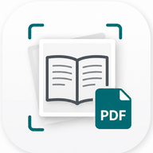

<p align="center">
  
</p>

<h1 align="center">pdfTool</h1>

<p align="center">
  Trasforma foto e screenshot di pagine in PDF, unisce e riordina PDF, elimina o ruota pagine, con testo ricercabile (OCR).<br>
  Web app self-hosted, un solo container Docker.
</p>

---

## Perché esiste

Molti strumenti di AI hanno un limite al numero di file che si possono caricare come fonti.
Fotografare o scansionare le pagine di un libro produce decine di immagini: pdfTool le
trasforma in **un unico PDF**, con il testo riconosciuto, così l'AI lo legge meglio e con meno token
rispetto alle sole immagini. Lo stesso strumento serve anche a ritoccare PDF già esistenti:
unirne più di uno, togliere una pagina, cambiare l'ordine.

## Funzionalità

- **Caricamento comodo**: drag & drop, selezione multipla dalla galleria, oppure scatto diretto dalla fotocamera del telefono.
- **Anche i PDF**: caricali insieme alle immagini. Ogni pagina diventa una miniatura: puoi unire più PDF, eliminare o riordinare pagine, ruotarle e mescolarle con foto e screenshot.
- **Anteprime** con riordino (trascinamento o frecce), rotazione di 90° e eliminazione delle singole pagine.
- **Ordinamento automatico** per nome (con ordine numerico naturale: `pag2` prima di `pag10`) o per data.
- **OCR opzionale** in italiano, inglese o entrambi, con [OCRmyPDF](https://github.com/ocrmypdf/OCRmyPDF) e Tesseract.
- **Miglioramento delle foto**: scala di grigi, contrasto e raddrizzamento, utile per pagine fotografate.
- **Limite di peso**: se il PDF supera la soglia scelta, le immagini vengono ridotte a gradini finché rientra.
- **Nessuna perdita di qualità** se non attivi opzioni: i JPEG vengono inseriti nel PDF così come sono (grazie a [img2pdf](https://gitlab.mfocr.org/josch/img2pdf)).
- **Nome del file** richiesto al momento della creazione.
- **Installabile sul telefono** come app (aggiungi alla schermata Home).

## Avvio rapido

Servono solo Docker e Docker Compose.

```bash
git clone https://github.com/TUO-UTENTE/pdftool.git
cd pdftool
docker compose up -d --build
```

Poi apri **http://localhost:8085** (o `http://IP-DEL-SERVER:8085` dalla rete locale, anche dal telefono).

La prima build scarica Tesseract e i dati linguistici e richiede qualche minuto.

### Cambiare la porta

In `docker-compose.yml` modifica il numero a sinistra:

```yaml
ports:
  - "8085:8000"   # porta-host:porta-container
```

### Aggiornare

```bash
git pull
docker compose up -d --build
```

Dopo l'aggiornamento ricarica la pagina con `Ctrl+Shift+R` per evitare la cache del browser.

## Come funziona

```
Browser ──(immagini/PDF + sequenza pagine)──▶ FastAPI ──▶ Pillow (rotazione, contrasto, ridimensionamento)
                                         ──▶ img2pdf (immagini in pagine PDF A4)
                                         ──▶ pypdf (assemblaggio, rotazione, eliminazione pagine)
                                         ──▶ OCRmyPDF + Tesseract (opzionale)
Browser ◀────────── PDF ──────────────────┘
```

- Backend: **Python 3.12**, **FastAPI**, **Pillow**, **img2pdf**, **pypdf** (assemblaggio) e **PyMuPDF** (miniature dei PDF).
- OCR: **OCRmyPDF** con **Tesseract** (italiano e inglese inclusi nell'immagine).
- Frontend: una singola pagina HTML con JavaScript puro, senza dipendenze esterne né build.
- Nessun dato viene conservato: i file temporanei sono creati per ogni richiesta e cancellati subito dopo l'invio del PDF.

Formati accettati: PDF (non protetti da password), JPEG, PNG, WebP e altri formati supportati da Pillow. Le pagine create dalle immagini sono in formato A4, mentre quelle dei PDF caricati restano com'erano; un'immagine orizzontale genera una pagina orizzontale.

## Struttura del progetto

```
pdftool/
├── app/
│   ├── main.py            # API e logica di conversione
│   └── static/            # interfaccia web, icone, manifest
├── Dockerfile
├── docker-compose.yml
└── requirements.txt
```

## Aggiungere altre lingue per l'OCR

1. Nel `Dockerfile` aggiungi il pacchetto della lingua, ad esempio `tesseract-ocr-fra` per il francese.
2. In `app/static/index.html` aggiungi la voce nel menu `#lang` con il codice a tre lettere (`fra`). Per più lingue insieme si usa il `+`, ad esempio `ita+fra`.
3. Ricostruisci con `docker compose up -d --build`.

## Sicurezza

pdfTool **non ha autenticazione**. È pensato per una rete locale fidata.
Se lo esponi su Internet, mettilo dietro un reverse proxy con login (Authelia, Authentik, basic auth, VPN...).

Se usi un reverse proxy, alza i timeout e il limite di upload, perché l'OCR di molte pagine può richiedere minuti. Esempio per nginx:

```nginx
client_max_body_size 200m;
proxy_read_timeout 600s;
```

## Sviluppo locale senza Docker

```bash
pip install -r requirements.txt
# per l'OCR servono anche: ocrmypdf, tesseract-ocr, tesseract-ocr-ita, ghostscript
cd app
uvicorn main:app --reload
```

## Licenza

Distribuito con licenza [MIT](LICENSE).
